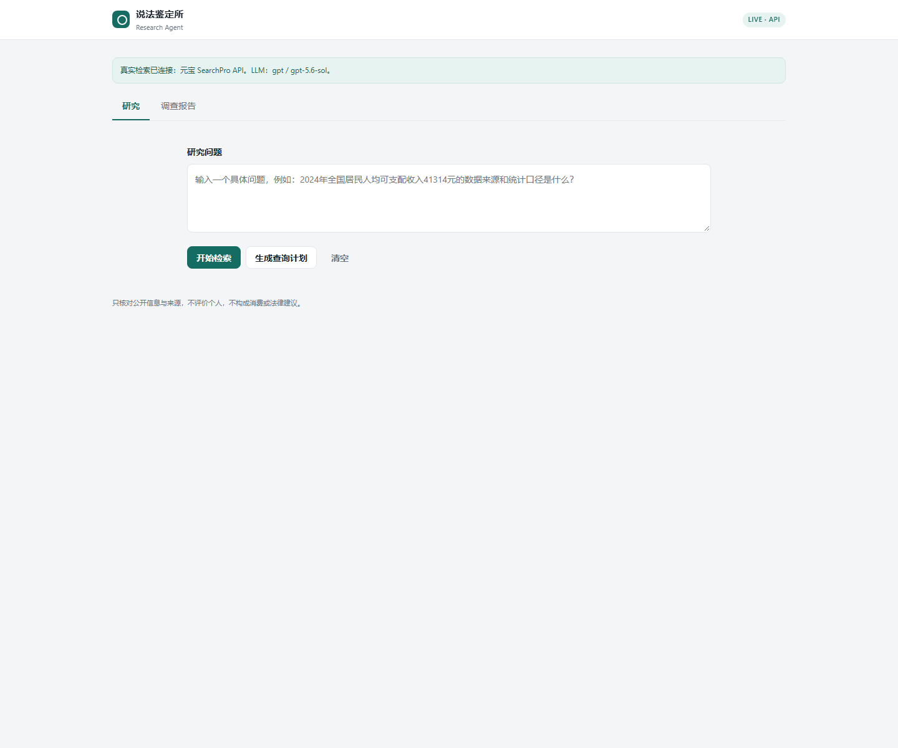
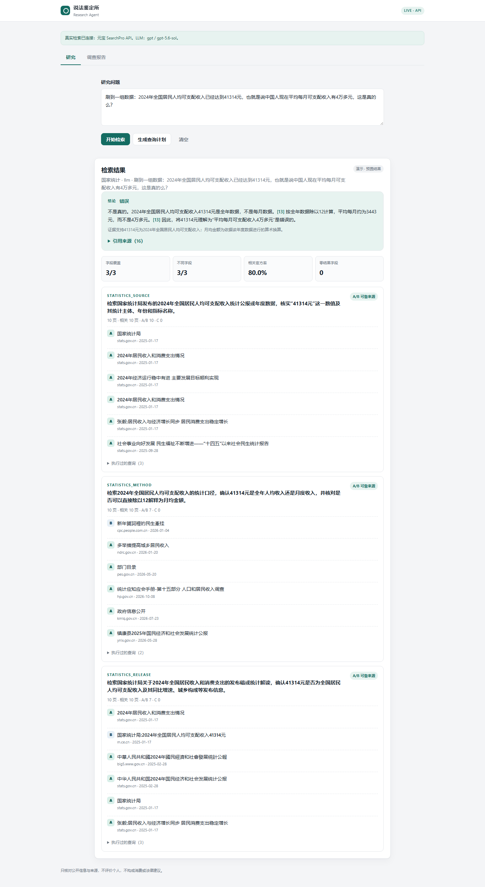
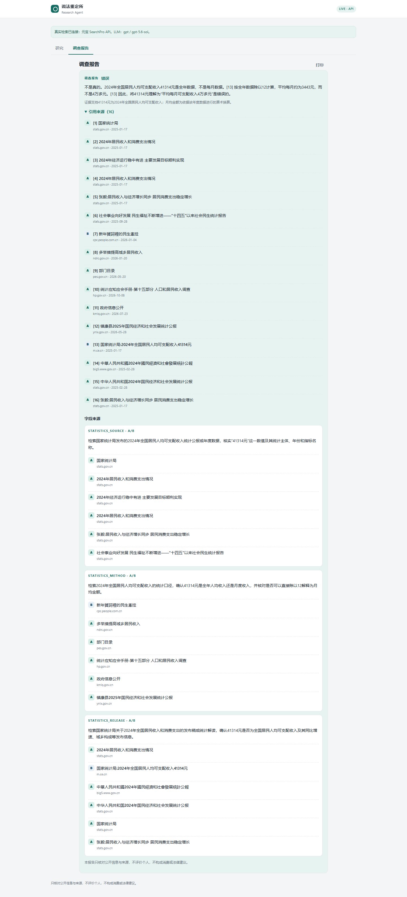

# YuanBao_Search / 说法鉴定所 · 项目现状与架构分析

> 分析时间：2026-10-25（Asia/Shanghai）  
> 分析对象：`D:\AI_projects\YuanBao_Search` 工作区（含**未提交**的 v2.6 改动）  
> 方法：静态代码阅读 + `pytest` 全量执行 + 在 8010 端口启动当前代码做零成本接口/演示实测 + 无头 Chrome 实际操作 UI 并截图 + SQLite/JSONL/缓存抽查  
> 说明：文中“主路径”指当前 Web UI 实际调用的 `research_topic` 链路；“legacy 路径”指仍保留但 UI 不再使用的 `verify_claim` 链路。

---

## 0. 结论摘要

1. **项目可运行、演示链路可用**：85 个测试全部通过；当前代码在 8010 端口启动正常；三条演示问题命中 `demos/` 后秒回，回答、指标、调查报告均能渲染，打印入口可点击（已实测截图）。
2. **代码主体是两条并行链路**：`claimlab/research.py`（研究问题 → 需求拆分 → LLM 查询 → 检索 → 分级 → LLM 回答/报告）与 `claimlab/pipeline.py`（说法 → 断言 → 查询 → 去重 → 分级 → 匹配 → R1–R5 判定 → 报告）。**Web UI 只用前者；后者仍占约一半代码与全部“判定”能力。**
3. **最重要的事实性风险**：回答阶段只把“标题/域名/日期/URL”交给 LLM，**没有把检索摘要（passage/content）交给模型**，因此“结论”并不是对证据正文的核验；同时 `[n]` 引用没有做存在性/范围校验。这与 README/规则页宣称的“不编造、结论可核验”存在明显落差。
4. **8000 端口运行的是旧进程**（2026-10-24 22:15 启动）：`/api/db/*` 缺失已实测；演示快路径缺失据进程启动时间（早于 `demos.py` 创建）推断。新前端静态文件却是从磁盘实时读取的，形成“新 UI + 旧后端”的混合状态。按 PROJECT_PLAN 的 V1–V4 验收前必须先重启。
5. **文档与实现存在多处漂移**：预算 8/56/800（config 默认/PROJECT_PLAN）vs 4/28/400（`.env`/rules.html）；`/api/plan` 仍注入 subject/city 且用模板查询，而 `/api/research` 不注入且用 LLM 查询（预览 ≠ 执行）；主路径不跑去重/判定，但 README 的 skills 目录说明、PROJECT_PLAN、framework.html、`/api/skills`、`/rules` 都把它们列为能力或主路径。
6. **v2.6 尚未入库**：12 个已修改文件 + 4 个未跟踪文件（`claimlab/demos.py`、`claimlab/skills/research_report.py`、`demos/`、`scripts/prepare_demos.py`），远端 GitHub 落后于本地。
7. **测试覆盖偏科**：85 个测试集中在 legacy skills/keys/契约；**没有任何测试覆盖 `run_research`、`/api/research`、`/api/plan`**，演示匹配测试在 `demos/` 缺失时会直接 `return` 空跑。

---

## 1. 项目定位与当前状态

### 1.1 它是做什么的

`说法鉴定所 / YuanBao Research Agent` 是一个**中文公开信息核查与研究报告生成**应用：

```text
研究问题（文字）
  → 演示快路径（命中 demos/ 直接返回）
  → S1 需求拆分（1–3 条 Requirement）
  → S2 LLM 构造 SearchPro 查询（Query/Site/Industry/Freshness/Cnt）
  → S3 检索网关（缓存 / 预算 / 审计）
  → 来源分级（A–E）与 A/B、B/C、insufficient 分层
  → LLM 回答 + [n] 引用
  → 调查报告（终端 Markdown / Web 标签页 / JSON 字段）
  → SQLite 索引（历史/统计/CSV）
```

三条演示问题覆盖：国家统计公报、历史/文化遗产、市政通知（电动自行车新规）。

### 1.2 实测状态（本次分析）

| 检查项 | 结果 | 证据 / 命令 |
|---|---|---|
| 测试 | **85 passed in 1.96s** | `./.Search/Scripts/python.exe -m pytest -q` |
| Python / 依赖 | 3.13.5；fastapi 0.161.1、uvicorn 0.54.0、httpx 0.28.1、pydantic 2.14.1 | 运行时导入 |
| 当前代码启动 | 正常（8010 端口） | `APP_PORT=8010 python -m claimlab.api` |
| 健康检查 | 200；DB available；5 runs / 68 sources | `GET /api/health`、`/api/db/stats` |
| 路由（当前代码） | 含 `/api/db/*`、`/api/report`、SSE、`/rules` | `/openapi.json` |
| 演示 q1 | `demo=true`，3 需求 / 6 查询 / 30 页 / 3-3 A/B / 16 引用 / report 存在 | `POST /api/research` |
| 演示是否入库 | **否**：DB runs 5 → 5 | 前后 `/api/db/stats` |
| 演示 q2 计划 | `demo=true`，2 需求 / 4 查询 | `POST /api/plan` |
| 自定义计划 | 走 LLM（`method=llm`），查询质量正常 | `POST /api/plan` |
| 无 Key 离线研究 | **0 页 / insufficient / 规则回答** | `build_sandbox(force_fake=True)` + `run_research` |
| Web UI | 首页/规则/静态资源 200；演示结果与报告均渲染 | 无头 Chrome + CDP 实测 |
| 8000 端口 | **旧进程**（2026-10-24 22:15:34 启动，PID 29444） | 进程创建时间 + `/openapi.json` 缺 `/api/db/*` |
| Git | HEAD `270ec3c`；12 改 + 4 未跟踪；remote GitHub | `git status` / `git log` |
| 预算实际值 | **4 / 28 / 400**（来自 `.env`） | `/api/health.settings.budgets` |
| 本地数据量 | cache/search 141 文件 13.2 MB；archive 88 文件 48.8 MB；DB 77 KB | 目录统计 |

### 1.3 工作区里还有什么

这些目录**不是 claimlab 运行时的一部分**，但会干扰对项目的第一印象，需要区分：

| 路径 | 性质 | 是否入库 |
|---|---|---|
| `1024侦察赛道-评审提交包-20261024/` | 队友的“1024 侦察赛道”平台（标准库 `http.server`、端口 8899、自带前端/DB/演示线路），只在 `平台/search.py` 头部注明协议参考了 `claimlab/search/api.py`；**无代码依赖** | 否（`.gitignore` 排除） |
| `.archify/` | archify 生成框架图的过程产物（candidate/finalize/browser-check 多版本） | 否 |
| `framework.html` | 当前架构图 v3（771 KB、13 466 行，内联 SVG/CSS，无外部依赖） | 是 |
| `probe/` | SearchPro/LLM 探针原始响应、去重标定卡、旧 UI 截图 | 否 |
| `archive/`、`cache/`、`state/`、`logs/` | 运行产物：JSONL 审计、磁盘缓存、SQLite/预算、日志 | 否 |
| `deliverables/screenshots/` | 旧版 UI 截图（含 MCP 时代的“输入一条说法”页） | 是（旧图已过时） |
| `.Search/` | 项目自带 Python 3.13 venv | 否 |

> 本次新增的 5 张当前 UI 截图见 [deliverables/screenshots](deliverables/screenshots)（`current-ui-*.png`），用于替代已过时的旧截图。

---

## 2. 目录结构与模块划分

### 2.1 规模

| 区域 | 文件数 | 行数 | 说明 |
|---|---:|---:|---|
| `claimlab/` | 41 | 6 424 | 应用核心（API、运行时、两条链路、skills、search、llm、store） |
| `web/` | 4 | 801 | 原生 HTML/CSS/JS，无构建、无框架 |
| `config/` | 4 | 319 | 领域、查询模板、词典、LLM 供应商 |
| `scripts/` | 13 | 1 946 | 配置密钥、探针、批量检索、演示预生成、Git 推送 |
| `tests/` | 13 | 1 007 | 85 个 pytest 用例 |
| 合计 | 75 | ≈10 500 | 不含数据/缓存/归档 |

### 2.2 顶层职责

```text
claimlab/
├── api.py            463  FastAPI 装配 + 全部 HTTP 路由（研究/计划/DB/SSE/报告/静态页）
├── __main__.py         6  python -m claimlab → cli.main
├── cli.py            112  run / serve / doctor / fixtures 四个子命令
├── config.py         183  Settings、极简 .env 解析、目录布局
├── contracts.py      422  全部 dataclass 契约 + jsonable/dumps/VALID_CNT
├── runtime.py         94  Sandbox：provider/LLM/缓存/归档/DB/预算/管线装配
├── research.py       258  研究主路径执行器（demo → 需求 → 查询 → 检索 → 分级 → 回答 → 报告）
├── pipeline.py       534  legacy 说法验证管线（断言 → 检索 → 去重 → 匹配 → R1–R5 → 报告）
├── demos.py           60  演示快照 load/save/match（精确 question 归一化）
├── runs.py           153  内存 RunStore + SSE 事件流 + 取消（legacy）
├── keys.py           294  Bearer 归一化、LLM 供应商注册表、模型选择
├── logging.py         54  RotatingFileHandler + event=key=value 结构化日志
├── fsutil.py          39  Windows 友好的原子写（重试 os.replace）
├── llm/client.py     359  OpenAI 兼容客户端 + /models 自动选型 + FakeLLM
├── search/
│   ├── api.py         92  SearchPro REST provider（httpx.AsyncClient）
│   ├── normalize.py  215  Pages 字符串/双层 JSON 归一化、日期/域名/strength
│   ├── gateway.py    223  单入口：缓存 → 预算 → provider → 缓存写 → 审计
│   ├── budget.py     123  单断言/单次/单日/墙钟预算 + 每日持久化
│   ├── cache.py       65  SHA-256 键的磁盘缓存（TTL）
│   ├── archive.py     65  按 run 追加 JSONL 审计
│   ├── fake.py        70  基于 fixture `_triggers` 的确定性假 provider
│   └── base.py        41  Provider 协议 + 健康结构
├── skills/
│   ├── requirements.py 272  S1 需求拆分（LLM + 关键词回退）
│   ├── query.py        488  S2 查询构造（模板/LLM/回退/再查询/时间序列）
│   ├── grading.py      110  A–E 域名分级 + 时效降级
│   ├── source_policy.py 50  relevant / A/B、B/C、insufficient 分层
│   ├── dedup.py        125  5-gram + Jaccard 连通分量
│   ├── matching.py     246  支持/反驳/无关 + 引文子串校验
│   ├── judging.py      269  R1–R5 字典序判定 + 分层结论 + 计票
│   ├── extraction.py   238  legacy 断言/情绪抽取
│   ├── answer.py       114  引用编号 + 结论生成（LLM/规则）
│   ├── research_report.py 88 调查报告（JSON + Markdown）
│   ├── reporting.py    112  legacy 报告（契约 C）
│   ├── safety.py        70  时政/个人/敏感词/PII
│   └── __init__.py      19  统一导出
└── store/
    ├── fixtures.py     62  fixtures 读取/公开列表
    └── db.py          218  SQLite 索引（runs/sources，失败降级）
```

### 2.3 依赖方向

```text
web/app.js ──HTTP──► claimlab/api.py
                        │
                        ├─► runtime.py ──► llm/client.py ──► keys.py
                        │        │                 └─► search/cache.py
                        │        ├─► search/gateway.py ──► search/api.py ──► search/normalize.py
                        │        │        ├─► search/budget.py
                        │        │        └─► search/archive.py
                        │        └─► store/db.py
                        │
                        ├─► research.py ──► skills/{requirements,query,grading,source_policy,answer,research_report}
                        │        └─► demos.py ──► demos/*.json
                        │
                        ├─► pipeline.py ──► skills/{extraction,query,dedup,grading,matching,judging,reporting,safety}
                        │        └─► search/{gateway,budget,archive,normalize}
                        │
                        └─► runs.py（内存 RunStore / SSE）
```

- 依赖方向基本单向：`api → runtime/research/pipeline → skills/search/llm → contracts/config`；`contracts` 无业务依赖，可独立测试。
- **没有循环依赖**；`skills` 之间只有 `source_policy → grading`、`answer → 无`、`research_report → 无` 这类浅依赖。
- `claimlab/skills/__init__.py` 一次性导入全部 skill，导致任何 `from claimlab.skills import x` 都会加载全部模块；对启动时间影响很小，但耦合面偏大。

### 2.4 外部依赖

`requirements.txt` 仅 4 项：`fastapi`、`uvicorn`、`httpx`、`pytest`。  
**没有** ORM（直接 `sqlite3`）、**没有** `python-dotenv`（`config.py:24` 自写 20 行解析器）、**没有** pydantic 模型层（只有 FastAPI 请求体用了 `BaseModel`）、**没有**前端构建链。这是有意为之的“小部署面”设计。

---

## 3. 启动与运行时装配

### 3.1 入口

| 入口 | 行为 |
|---|---|
| `python -m claimlab.api` | 导入 `api.py` → 模块级 `app = create_app()`（`api.py:457`）→ `__main__` 里 `uvicorn.run(app, host, port)` |
| `python -m claimlab.cli serve` | `uvicorn.run("claimlab.api:app", ...)`，等价但延迟导入 |
| `python -m claimlab` | 走 `cli.main()`，默认无子命令会报错 |

注意：`app = create_app()` 在**导入时**执行，会立即建目录、配置日志、加载 fixtures、构建 provider/LLM/SQLite。副作用是：任何 `import claimlab.api` 的脚本都会初始化运行时（测试若要导入 API 需注意）。

### 3.2 Settings 与 .env

- `load_settings()`（`config.py:152`）先 `load_env_file()`：只解析 `KEY=VALUE`，跳过注释/空行，**不覆盖已存在的环境变量**（`os.environ.setdefault`）。
- 目录常量在 `config.py:13-21`：`ROOT/config/fixtures/cache/archive/state/web/logs/deliverables`。
- `ensure_dirs()` 创建 `cache/archive/state/logs/deliverables`。
- `public_dict()`（`config.py:129`）只输出布尔/模型/预算等**非密钥**信息，给 `/api/health` 用。
- 当前 `.env`：`SEARCH_PROVIDER=api`、`SEARCH_API_KEY` 已配、`LLM_MODEL=gpt-5.6-sol`、`LLM_PROVIDER=gpt`、预算 `4/28/400`、`OFFLINE=false`。密钥值未在本文打印。

### 3.3 Sandbox：一次装配，多处复用

`runtime.py:20` 的 `Sandbox` 持有：

| 成员 | 类型 | 生命周期 |
|---|---|---|
| `settings` | `Settings` | 进程级 |
| `providers` | `{"api": ApiSearchProvider}` 或 `{"fake": FakeSearchProvider}` | 进程级（httpx client 复用） |
| `fixtures` | 全部 fixtures 字典 | 进程级 |
| `llm` | `OpenAICompatLLM` 或 `FakeLLM` | 进程级（按 provider 缓存 httpx client） |
| `archive` | `ArchiveWriter` | 进程级 |
| `cache` | `DiskCache("search")` | 进程级 |
| `store` | `Store(state/platform.db)` | 进程级 |

- `new_budget()`：**每次研究/管线运行新建一个 Budget**，因此“单次运行预算”是 per-request 的；每日计数从 `state/budget-YYYY-MM-DD.json` 读取。
- `new_gateway()`：每次研究新建 gateway（缓存/归档是共享的，预算是独立的）。
- `new_pipeline()`：给 legacy `/api/runs` 用。
- `health()`：provider 的 `health()` 是**配置级**的（只判断 key 是否存在，`search/api.py:81`），不会真的发请求；因此 UI 的 “LIVE · API” 不能证明 key 有效。
- `close()`：FastAPI lifespan 结束时关闭 provider/LLM 的 httpx client。

### 3.4 provider 选择与降级

`build_sandbox()`（`runtime.py:83`）：

```python
use_fake = force_fake or settings.search_provider == "fake" or not settings.search_api_key
if use_fake:
    settings.search_provider = "fake"
    settings.offline = False
    providers = {"fake": FakeSearchProvider(fixture_pages(fixtures))}
else:
    providers = {"api": ApiSearchProvider(settings)}
llm = build_llm(settings)   # 无 LLM key → FakeLLM
```

- 无 Search key → fake provider（fixtures 的 `mock_pages`，按 `_triggers` 子串匹配 query）。
- 无任何 LLM key → `FakeLLM`（只实现 `extract_claims` / `match_evidence` 两个 legacy 任务，其它任务返回 `{}`）。
- 这解释了为什么“无 Key 的 DEMO 研究路径”会失效：`build_queries_llm` 拿不到查询，回退到模板，而模板查询又不再包含 subject，fake provider 的 trigger 匹配不到（详见 §11 高-4）。

### 3.5 请求生命周期

- `/api/research`：同步等待整个研究完成（通常 10–20 秒），没有 SSE/进度；HTTP 超时由客户端决定。
- `/api/runs`（legacy）：创建 `asyncio.Task`，立即返回 `run_id`，通过 `/api/runs/{id}/events` 的 SSE 推送事件；支持 `cancel`。
- `/api/health`：每次调用会遍历 providers 的 `health()`（当前实现是纯内存判断，无网络）。

---

## 4. 两条执行链路

### 4.1 研究主路径（Web UI 实际使用）

入口：`POST /api/research` → `api.py:302` → `run_research()`（`research.py:40`）。

```text
app.js runResearch()
  │  POST /api/research {text, refresh:false}
  ▼
api.research()
  ├─ resolve_research_input()        # api.py:160：example 只提供默认 question/subject/city
  ├─ ResearchTask(mode="research_topic")
  ├─ run_research(sandbox, task, example_id, refresh)
  │    ├─ match_demo(text, example_id)         # 命中 → 直接返回预置 payload
  │    ├─ sandbox.new_gateway()                # 新 Budget + 共享 cache/archive
  │    ├─ decompose_requirements(llm, task)    # S1：LLM JSON，失败回退关键词
  │    ├─ for each requirement:
  │    │    ├─ build_queries_llm(llm, req)     # S2：LLM 构造 2–4 条
  │    │    │    └─ 空 → plan_requirement_queries() 模板回退
  │    │    ├─ initial[:2] → gateway.search()  # S3：缓存/预算/审计
  │    │    ├─ source_tier(pages, req)         # A/B | B/C | insufficient
  │    │    ├─ if insufficient → plan_fallback_queries()[:1] → search
  │    │    ├─ if still insufficient → plan_requery_queries()[:1] → search
  │    │    └─ 计算 relevant/grades/top_sources（A/B/C，最多 6 条）
  │    ├─ 汇总 metrics（字段覆盖、A/B 页率、零结果、缓存命中…）
  │    ├─ store.upsert_run / upsert_sources    # SQLite（异常静默）
  │    ├─ build_answer(llm, question, rows)    # LLM 回答 + [n]；失败走规则
  │    └─ build_research_report(...)           # 报告 JSON
  └─ jsonable(payload) → 200
```

响应顶层字段（`research.py:244`）：

```json
{
  "run_id": "research-YYYYMMDD-HHMMSS-xxxxxx",
  "example_id": "q1_statistics_bulletin | null",
  "domain": "...", "method": "llm|heuristic",
  "question": "...",
  "requirements": [...], "queries": [...],
  "fallback_queries": [...], "requery_queries": [...],
  "results": [...], "metrics": {...},
  "answer": {...}, "report": {...},
  "demo": true   // 仅演示命中
}
```

关键设计：

- **每次运行最多 1 个 gateway / 1 个 Budget**；每个 requirement 最多 2 条初始 + 1 条回退 + 1 条再查询 = 4 次检索；3 条需求 = 12 次上限（单次运行预算 28）。
- **没有并发**：requirement 串行、query 串行；实现简单、可复现，但 10–20 秒的等待感明显。
- **没有 dedup**：`pages` 是各 query 结果的简单拼接；同一 URL 多次命中会重复计数（见 §11）。
- **没有判定**：`tier` 只表示“有没有 A/B 或 C 级来源”，不表示说法成立/不成立；结论完全由 `answer` 的 LLM 生成。

### 4.2 演示快路径

```text
scripts/prepare_demos.py
  └─ 对 examples/*.json 的已填问题各跑一次 run_research（真实检索 + LLM）
       └─ payload["demo"]=True → demos/<example_id>.json

运行时：
  match_demo(text, example_id)
    ├─ example_id 存在 → load_demo(example_id)   # 优先级最高
    └─ 否则按 normalize(text) 精确匹配任意 demo 的 question
```

- 命中后 `run_research` **在创建 gateway 之前**直接返回，因此：零检索、零 LLM、零预算、不写 SQLite、不写 archive。
- 演示 payload 是“完整快照”：requirements/queries/results/metrics/answer/report 都固化在 JSON 里。
- 当前三个快照：q1 3 需求/6 查询/30 页/3-3 A/B/16 引用；q2 2/4/35/2-2/8 引用；q3 3/6/40/3-3/15 引用；answer.engine 均为 `llm`。
- **风险**：快照与当前代码/真实检索结果会漂移；且 `example_id` 优先于 `text`（见 §11 高-3）。

### 4.3 legacy 规则验证路径（`/api/runs`）

入口：`POST /api/runs` → `RunStore.create` → `asyncio.create_task(execute)` → `Pipeline.run`（`pipeline.py:140`）。

```text
Pipeline.run
  ├─ safety.check_task(task)                 # 时政/个人/长度
  ├─ extraction.extract_claims(llm, task)    # LLM 抽断言，失败启发式
  ├─ facts[:3]
  ├─ for claim:
  │    ├─ round 0 / 1
  │    ├─ query_skill.plan_queries(...)      # 模板查询（会注入 subject/city）
  │    ├─ gateway.search(...)                 # 预算/缓存/审计
  │    ├─ dedup.cluster_pages(...)            # 5-gram Jaccard
  │    ├─ matching.match_evidence(...)        # LLM + 引文子串校验
  │    ├─ judging.judge_unit(...)             # R1–R5
  │    └─ 无进展/预算/取消 → 停
  ├─ reporting.build_report(...)              # 契约 C
  └─ run.stats / run.done（SSE）
```

该路径的产物：

- 内存 `RunStore`（最多 50 个 run，重启即失）。
- `archive/<run_id>.jsonl`（每个事件 + 每次 search 的完整响应）。
- 不写 SQLite。
- UI 不调用；`/api/report/{run_id}` 只能取到内存 run 的报告。

### 4.4 两条链路对比

| 维度 | research（主路径） | verify_claim（legacy） |
|---|---|---|
| 输入 | 研究问题 | 可证伪说法 |
| 入口 | `POST /api/research`、`run_example_live.py` | `POST /api/runs` + SSE、`cli run` |
| 需求/断言 | `Requirement`（1–3 条） | `Claim`（facts ≤3） |
| 查询 | LLM 构造（回退模板） | 纯模板（`plan_queries`） |
| 去重 | **无** | 5-gram + Jaccard |
| 匹配 | **无**（只分级） | LLM/heuristic + 引文校验 |
| 判定 | **无**（LLM 结论） | R1–R5 确定性判定 |
| 回答 | LLM + 标题/URL 列表 | 规则化 action + 证据引用 |
| 持久化 | SQLite（无 answer/report） | 内存 + archive JSONL |
| 测试 | **0 个端到端** | 4 个 pipeline 测试 |
| UI | 研究/报告 tabs | 无入口 |

> 这是本项目最需要确认的产品问题：**“确定性判定”是项目最有价值的设计，但它不在当前 UI 的链路上。**

---

## 5. 核心功能实现原理

### 5.1 S1 需求拆分（`skills/requirements.py`）

- `decompose_requirements(llm, task)`（`requirements.py:247`）：
  - 有 LLM → `llm.json("decompose_requirements", payload, SYSTEM_PROMPT)`；
  - 任何异常/非法结构 → `heuristic_decompose`；
  - `_normalize_llm_plan` 校验 `field` 必须在 `REQUIREMENT_FIELDS` 中，否则 `unknown`；最多 3 条。
- 字段体系（11 个 + unknown）：
  - 统计：`statistics_source / method / release`
  - 历史/遗产：`scenic_history / scenic_explanation / heritage_status`
  - 市政/交通：`municipal_notice / municipal_effective / traffic_restriction / ev_license / ev_restriction`
- 每条 Requirement 带：`time_window`（字段默认窗口）、`source_preference`（gov/news/acad）、`search_terms`（年份、数字、引号词、字段词）。
- 启发式：`_infer_fields` 关键词命中；`_extract_terms` 用正则抽 20xx 年份、≥2 位数字、引号内词、字段词；**不抽取主体名**（v2.6 移除了 subject/city 注入）。
- 设计优点：LLM 只负责“拆得合理”，字段白名单和 1–3 条上限由代码兜底；输出直接是查询构造的输入。

### 5.2 S2 查询构造（`skills/query.py`）

两条实现并存：

1. **LLM 构造（研究主路径）**：`build_queries_llm`（`query.py:462`）
   - 输入只给 `text/field/source_preference/time_window/search_terms`，**不给 subject/city**；
   - Prompt 要求“2–4 条自然语言查询，把主体、城市、年份、指标写进 query”；
   - `coerce_llm_queries`（`query.py:413`）做字段白名单：`industry ∈ {gov,news,acad}`、`freshness ∈ {d30,m3,m6,y1,y2,y5}`、`cnt` 吸附 10/20/30/40/50、非法值置 None；
   - `precision = precise if (site or industry) else fuzzy`。
2. **模板构造（计划预览 / 回退）**：`plan_requirement_queries`（`query.py:221`）→ `plan_queries`（`query.py:103`）
   - 从 `config/queries.json` 取该 field 的 `variants/precise/freshness`；
   - 第一轮：精确（带 site/industry）+ 目标词扩展 + 同义改写；
   - 第二轮：换 Industry / 换 Site / 换表述，且 `used` 去重；
   - `plan_fallback_queries`：去掉 site/industry，只用 terms；
   - `plan_requery_queries`：反向 variants + 官方字段 industry=gov；
   - `plan_time_series_queries`：按 freshness 窗口/年份扫，供 `broad_search.py`。

设计优点：

- “重试必须换策略”（换 Site/Industry/表述），避免同参数重跑。
- 查询统一落到 `QueryPlan`，字段与 SearchPro 请求同构，便于缓存键和审计。
- `_clean_terms` 去掉与 subject/city/模板重复的词，避免“国家统计局 国家统计局”。

需要注意：

- v2.6 把 `city_value/subject_value` 改成只取函数参数，**不再回读 `requirement.subject/city`**；而 `/api/plan` 仍显式传 subject/city（`api.py:246-259`），`/api/research` 不传（`research.py:64-73`）。同一需求在“预览”和“执行”中会得到不同查询。
- `plan_queries` 与 `_target_values` 里仍有未使用的 `default_city = config.get("default_city", "西安")`（`query.py:114/246`），说明“默认城市”已被废弃但没清理。

### 5.3 S3 检索网关（`search/gateway.py`）

`gateway.search(run_id, assertion_id, plan, use_cache=True)` 的顺序：

```text
1. plan.to_request() → SearchRequest
2. 记录 search.start 事件
3. key = sha256("search", settings.search_provider, request.to_api_body())
4. cache.get(key) 命中 → budget.hit()（不扣费）→ archive.write_search(cache_hit=True) → 返回
5. settings.offline → 返回 error_kind="cache"（离线只能读缓存）
6. budget.charge(assertion_id) → 超限返回 error_kind="budget"
7. _candidates() → 当前 api/fake 二选一
8. provider.search(request) → self.calls += 1
9. 成功 → 用 provider 名再算 key → pages 非空才 cache.set → archive.write_search → 返回
10. 失败 → archive + search.error → 返回
```

要点：

- **缓存命中不计费**；真实调用在发出前扣费（`budget.charge` 在 provider 调用之前）。
- 预算四层：单断言 `max_per_assertion`、单次运行 `max_per_run`、单日 `max_per_day`、墙钟 `wall_seconds`（`budget.py:77`）；每日计数落盘 `state/budget-YYYY-MM-DD.json`。
- `BudgetExceeded.reason` 会作为 `error_kind` 向上传播，管线把 `budget/auth/config/cache` 视为硬停。
- 审计 `ArchiveWriter.write_search` 记录完整 request/response（含 pages 与 raw），按 run 追加 JSONL。
- 潜在瑕疵：
  - 缓存查找用 `settings.search_provider`，写入用 `provider.name`（`gateway.py:128` vs `179-183`）；目前两者总是一致，但这是隐式假设。
  - provider 配置错误时**预算已经扣了**（charge 在 `_candidates` 检查之前）。
  - `_candidates()` 是一行嵌套三元表达式（`gateway.py:103-105`），可读性差。

### 5.4 响应归一化（`search/normalize.py`）

SearchPro 的 `Response.Pages` 可能是：

- JSON 字符串数组；字符串里可能再套一层 JSON（`_loads_maybe_twice`）；
- 数组/字典/混排。

`parse_pages_field` 递归 `consume`（深度 ≤2），坏 JSON 记 warning 跳过；`normalize_page` 统一：

- `url → domain_of()`（去 `www.`）；
- `date` 支持 5 种格式 + ISO；同时算 `age_days`；
- `pics/images` 兼容；
- `strength = full-ish | snippet | title`（按 content/passage 长度）。

这是整个项目里对“脏 API”防御最扎实的一层。

### 5.5 来源分级与分层（`grading.py` / `source_policy.py`）

- `grade_page(page, industry, field)`：
  - 域名匹配：`.gov.cn` → A；`config/domains.json` 最长后缀匹配 B/C/D/E；未知 → D；
  - `industry` 参数**只写进 reason，不改变等级**（`grading.py:80-85`）——这是刻意的反“用检索过滤器洗白来源”设计；
  - 时效降级：`FIELD_AGE_DAYS` 对历史/统计给 730/3650 天，其余 365 天；超过则降一级并 `older=True`。
- `source_tier(pages, requirement)`：
  - 先 `is_relevant`（要求 `search_terms` 任一命中页面文本）；
  - 有 A/B → `"A/B"`；否则有 B/C → `"B/C"`；否则 `"insufficient"`。
- 设计优点：等级可解释、可复现；不把“模型判断”混进来源等级。
- 需要注意：
  - `industry=gov` 的查询天然只返回 gov 域名 → 几乎必然是 A；因此“A/B 覆盖率 100%”部分是**查询策略自证**，不是独立的质量信号。
  - 指标里的 “official” 实际是 A+B（B 是媒体），`gateway._batch_fields` 里的 “official” 又只数 `.gov.cn`；同名不同义。
  - rules.html 写“超过 365 天降一级”，但代码对历史/统计有 730/3650 天例外（`grading.py:24-31`）。

### 5.6 去重 / 匹配 / 判定（仅 legacy）

- **去重**（`dedup.py:72`）：
  - 文本归一化（去标签、NFKC、小写、去标点）→ 字符 5-gram → Jaccard；
  - 并查集连通分量；每个 cluster 计 1 票；
  - 簇 ID = 成员 URL 排序后 SHA-1 前 6 位，保证顺序无关。
- **匹配**（`matching.py:188`）：
  - LLM 返回 `relation/quote/observed_value`；
  - `_validate_quote` 把 quote 与页面文本去空白后做**子串校验**，不匹配则降级为 unrelated（`quote_rejected=True`）；
  - 无 LLM 时用启发式（价格/营业状态/处罚/时间/许可/预约/地址/广告）。
- **判定**（`judging.py:106`）：
  - R1：A 级反驳且无 A 级支持 → `refuted`；
  - R2：A 级支持且无 A/B 反驳 → `established`；
  - R2b：≥2 个独立 B+ 簇支持、无 B+ 反驳、值不冲突 → `established`；
  - R3：A 支持+A 反驳 / B 支持+B 反驳 / 同字段 ≥2 个不同值 → `conflict`；
  - R4：同源簇 ≥3、≥2 域名、断言缺可核验细节 → `suspect`；
  - R5r（放松）：有任何 relevant 证据（哪怕 C/D）→ `suspect`；
  - R5：其余 → `insufficient`。
  - 同时跑一遍“只看 A 级”的分层结论；计票按簇。
- 这套逻辑是项目最“可上台讲”的部分：**模型只读文本/写解释，判决由代码完成**。但它只在 legacy 路径生效。

### 5.7 回答与引用（`skills/answer.py`）

- `build_citations(rows)`：把各 row 的 `top_sources` 按 URL 去重，编号 [1..N]，保留 title/domain/grade/date。
- `build_answer(llm, question, rows)`：
  - 无引用 → “未检索到任何可引用来源，无法给出结论”。
  - 有 LLM → 把 **`[n] (grade) title — domain date\nurl`** 作为 evidence 交给模型；要求“只依据证据、每句带 [n]、不编造”。
  - LLM 失败/无 key → `_rule_answer`：按 tier 输出“有可靠来源佐证 / 有较可靠来源 / 无法确认”，引用 [n]。
- **关键缺陷**：`evidence_lines`（`answer.py:77-83`）只有标题/域名/日期/URL，**没有 passage/content**；`research.py:151-161` 构造 `top_sources` 时也只保留这 5 个字段。也就是说：
  - 模型看到的是“有哪些页面”，不是“页面说了什么”；
  - “结论”不可避免地依赖模型自身知识/常识，而不是检索摘要；
  - [n] 只能证明“该页面存在”，不能证明“该页面支持这句话”。
- **引用未校验**：`citations_used` 只过滤 1..N 范围，回答正文里的 `[n]` 不做存在性检查；若模型写出 `[17]`，UI 会生成指向不存在锚点的链接。

### 5.8 调查报告（`skills/research_report.py`）

- `build_research_report(question, rows, answer, metrics)`：组装 title/question/answer/verdict/uncertainty/engine/citations/fields/metrics/generated_at/disclaimer。
- `render_research_markdown(report)`：终端 `--report` 用；标题、结论、引用列表、字段来源、指标、免责声明。
- Web：`reportCard()`（`app.js:269`）渲染报告；字段来源、引用来源默认展开；打印按钮。
- 设计优点：终端与 Web 共用同一份报告 JSON，避免两套模板漂移。
- 需要注意：报告只存在于**当次响应/演示快照**；非演示 run 的 answer/report 不落库（见 §8）。

### 5.9 安全（`skills/safety.py`）

- `check_task`：空输入、>4000 字、`political_terms`（时政/领导人/选举/战争…）、`personal_markers`（博主/某先生/刘某…）。
- `mask_pii`：手机号、身份证。
- `lint_*_text`：banned_phrases（水军/刷单/收钱/骗子…）替换为 `[不当表述已移除]`。
- **只在 legacy `Pipeline.run` 调用**（`pipeline.py:154`）；`/api/research` 完全不调用 → 研究主路径没有时政/个人/长度护栏。
- `APP_API_TOKEN` 在 `Settings` 里定义（`config.py:85`）但全仓没有校验逻辑；目前仅靠 `APP_HOST=127.0.0.1` 保证本机访问。

---

## 6. 配置与密钥体系

### 6.1 配置文件

| 文件 | 作用 | 关键点 |
|---|---|---|
| `config/queries.json` | 19 个 field 的 variants/precise/freshness | 同时保留 legacy 餐厅字段（price/hours/address…）与研究字段；`default_city` 已无人使用 |
| `config/domains.json` | A–E 域名表、`age_downgrade_days`、`industry_cap` | `industry_cap` 无代码引用（死配置） |
| `config/lexicons.json` | 敏感词、PII、情绪词、处罚词、具体性正则、field_aliases | `subject_terms` 无代码引用 |
| `config/llm_providers.json` | gpt/codex 两个供应商、preferred/default、task_routes | 默认 provider=gpt；任务路由只覆盖 legacy 任务（extract/match/report/code），**没有 build_queries/answer 的路由** |
| `.env` / `.env.example` | 密钥、端口、预算 | 实际 `.env` 预算 4/28/400；`.env.example` 也是 4/28/400；`config.py` 默认 8/56/800 |
| `push.config.json` | GitHub 仓库/分支/作者 | 已 gitignore，不含 token |

### 6.2 密钥与 Bearer

`keys.py` 的两条规则：

1. Yuanbao Search 的 key 存裸值；`bearer_auth_header()` 保证**恰好一个** `Bearer ` 前缀（`keys.py:33-42`）。
2. LLM 走供应商注册表：`api_key_env → fallback_key_env → settings.llm_api_key → TOKLENS_API_KEY`；base_url 对 `lax.toklens.ai` 自动补 `/v1`。

模型选择链（`select_llm` / `choose_model`）：

```text
requested(model_hint > settings.llm_model > task_models > provider.task_models)
  → /models 目录精确匹配 / 前缀匹配
  → provider.preferred_models
  → provider.default_model
  → available[0]
```

设计优点：

- 供应商/模型配置化，自动适配第三方目录（当前 `gpt-5.6-sol`）。
- `/models` 结果按 provider 缓存；模型 404 时轮换候选（`client.py:193-204`）。
- `FakeLLM` 让无 key 的测试/演示可跑。
- `describe()/public()` 只暴露 key 是否存在/长度，不泄露值。

需要注意：

- `task_routes` 没有覆盖 `decompose_requirements/build_queries/answer`，这些任务会落到 default provider（gpt），而不是 codex；这是隐式行为。
- LLM 调用**没有预算/次数上限**；`max_agent_steps` 只是 health 里的展示值，没有任何 Agent 循环使用它。
- 每次研究通常 1 次需求拆分 + 最多 3 次查询构造 + 1 次回答 = 最多 5 次 LLM；没有总 token/费用闸门。

---

## 7. Web UI 设计与使用逻辑

### 7.1 页面结构（`web/index.html`）

```text
<header class="topbar">
  brand（说法鉴定所 / Research Agent）        #modeBadge（LIVE·API / DEMO / 连接中）
<main class="page">
  #notice（成功/警告/错误横幅）
  nav.tabs [研究] [调查报告]
  section#tab-research
    .composer  研究问题 textarea
               [开始检索] [生成查询计划] [清空]
    #planPanel（默认 hidden）
       查询计划 / 2 列：初始查询 | B/C 回退·再查询
    #researchPanel（默认 hidden）
       检索结果 / #answer / #metrics / #results
  section#tab-report（默认 hidden）
       调查报告 [打印] / #reportBox
  footer 免责声明
```

- 4 个文件、无构建、无 CDN、无框架；`/static/*` 由 FastAPI `StaticFiles` 提供。
- `index.html` 67 行，`app.js` 314 行，`styles.css` 337 行；`rules.html` 83 行（但首页没有链接到它）。

### 7.2 交互流程与状态机

```text
页面加载
  → init()：bind + GET /api/health
  → renderHealth：demo_mode/provider → badge DEMO/LIVE + notice
  → 失败：showError("无法连接本地服务")

研究 tab
  → 输入问题
  → [开始检索]（或 Ctrl/Cmd+Enter）
       → POST /api/research {text, refresh:false}
       → setBusy(true)：禁用 3 个按钮，按钮文案“检索中…”
       → 成功：renderResearch(data) + state.report = data.report
               state chip = “演示 · 预置结果” 或 “已完成”
       → 失败：chip=“失败”，notice 红色错误
  → [生成查询计划]
       → POST /api/plan {text, refresh:false}
       → renderPlan：method/需求数/查询数摘要 + 两列查询
       → 失败：chip=“失败”
  → [清空]：清空输入、隐藏两个面板、清空 report

调查报告 tab
  → switchTab('report')：若有 state.report → reportCard(state.report)
  → [打印]：window.print()

按钮互斥：busy 时 3 个按钮都 disabled；plan/research 面板互斥显示。
无：取消、历史、示例、主体/城市、跳过缓存、深链接、自动保存。
```

### 7.3 渲染函数与数据映射

| 函数 | 输入 | 输出 |
|---|---|---|
| `renderHealth` (`app.js:64`) | `/api/health` | badge 文案/颜色、notice（DEMO 警告或 LIVE 详情） |
| `renderPlan` (`app.js:136`) | `/api/plan` | 摘要 + `queryList` 两列；meta = field · precision · site/industry · freshness |
| `renderResearch` (`app.js:191`) | `/api/research` | answer 卡、4 个 metric、每个 field 一张 result-card |
| `answerCard` (`app.js:237`) | `answer` | 结论文本（`[n]` → `#cite-n` 锚点）、verdict、uncertainty、引用 details |
| `reportCard` (`app.js:269`) | `report` | 结论、引用（默认展开）、字段来源、免责声明 |
| `switchTab` (`app.js:41`) | tab 名 | 切换 `.active` 与 `hidden`；进 report 时按需重渲染 |

数据映射要点：

- 结果卡 tier：`A/B → “A/B 可靠来源”`、`B/C → “B/C 降级来源”`、其余 → “未找到可靠来源”。
- 指标：字段覆盖 `fields_with_ab/fields`、不同字段 `distinct_fields_with_ab/distinct_fields`、相关官方率 `relevant_official_rate`、零结果 `zero_requirements`。
- 来源：`grade/domain/title/url/date`；URL 经 `safeUrl` 只允许 http(s)。
- 执行过的查询折叠在 `<details>` 里，显示 strategy/query/pages/cache/error。

### 7.4 视觉设计

- 浅色主题、teal 主色 `#146c62`、灰底 `#f4f5f7`、白卡片、12px 圆角、轻阴影；中文字体 `Segoe UI/Microsoft YaHei`。
- 顶部 sticky + 半透明模糊；内容 `.page` 最大 1080px；`.tab-panel` 最大 880px。
- 组件：badge、notice（ok/warn/error）、metric、result-card、tier 标签、grade 方块 A–E、answer-box、report-field。
- 响应式：≤760px 单列；打印：隐藏 topbar/composer/actions/hint/notice/queries。
- **布局瑕疵**：`#notice` 与 `.tabs` 在 `.page`（1080）里，而两个 tab-panel 是 880 居中 → 实测横幅/标签栏比正文宽 100px，左边缘不在一条线上（见截图）。
- **打印瑕疵**：`@media print` 没有隐藏 `.tabs` 和 `#reportPrint`，打印出的报告会带“研究/调查报告”标签与“打印”按钮。
- **视觉残留**：`.intro/.examples/.example-chip/.field-grid/.field` 等类是旧版 UI 的样式，现已无 DOM 使用。

### 7.5 实测截图

当前代码（8010 端口）+ 演示 q1，经无头 Chrome 实测：







补充：`current-ui-plan.png`（查询计划面板）、`current-ui-rules.png`（`/rules` 判定口径页）。

实测结论：

- 演示命中后 state chip 显示“演示 · 预置结果”，answer 181 字，report 2 009 字；未观察到渲染错误。
- 结果页的来源列表出现**重复标题**（如“2024年居民收入和消费支出情况”两次、“张毅:居民收入与经济增长同步…”两次），引用 16 条中有 2 组同题不同 URL；报告页又把同一批来源在每个字段下重复一遍。
- 计划面板显示“llm · 3 条需求 · 6 条初始查询 · 2 条 B/C/再查询”，但**没有“演示”标识**，用户无法区分预置计划与实时计划。

### 7.6 可用性 / 可访问性缺口

- 无历史记录入口：`/api/db/*` 已实现，但 UI 完全没有使用（无历史/统计/导出页面）。
- 无示例入口：演示问题只能手动输入（README 里有，但页面没有）。
- 无“跳过缓存”开关：`formPayload` 永远 `refresh:false`。
- 无请求超时/取消：`fetch` 没有 `AbortController`，10–20 秒等待期间只能等。
- Tabs 只有 `data-tab`，没有 `role="tab"/aria-selected/tabpanel`；错误 notice 没有 `role="alert"`；键盘可用但没有方向键切换。
- 报告 tab 只在点击 tab 时重渲染；如果未来支持“报告 tab 常驻 + 后台跑”，需要显式刷新逻辑（当前流程下不构成 bug）。
- 打印依赖浏览器默认分页；长报告的分页/页眉没有专门 CSS。

---

## 8. 数据与存储

### 8.1 目录

| 目录 | 内容 | 是否入库 | 现状 |
|---|---|---|---|
| `cache/search/` | 每次 SearchPro 请求的归一化批次（SHA-256 键，TTL 72h） | 否 | 141 文件 / 13.2 MB |
| `cache/llm/` | LLM JSON 响应（键含 provider/model/task/prompt/payload） | 否 | 46 文件 / 61 KB |
| `archive/` | 按 run 追加 JSONL：search 事件（含完整 raw） | 否 | 88 文件 / 48.8 MB |
| `state/platform.db` | SQLite：runs + sources | 否 | 5 runs / 68 sources |
| `state/budget-YYYY-MM-DD.json` | 每日调用计数 | 否 | 今日 36 次（本次测试后恢复） |
| `demos/` | 3 个演示快照 | **是** | 84 KB |
| `logs/` | app/probe/example 日志，RotatingFileHandler | 否 | 45 文件 / 216 KB |
| `probe/` | 探针原始响应、标定卡、旧截图 | 否 | 1 MB |

### 8.2 SQLite 模式

```sql
runs(run_id PK, mode, question, subject, city, domain, method, status,
     metrics_json, result_json, created_at)
sources(source_id PK, run_id, field, url, domain, grade, title, date, passage)
```

- `Store` 初始化失败时 `available=False`，所有读写降级为 no-op（`db.py:53`）；研究流程不会因 DB 坏掉而失败。
- `upsert_run` 用 `ON CONFLICT(run_id) DO UPDATE`；`upsert_sources` 先删后插。
- `query_runs` 只按 question/run_id LIKE 搜索；`export_rows` 最多 5 000。
- `get_run` 解析 metrics/result + sources。

### 8.3 持久化缺口（重要）

- `run_research` 只写 `metrics` 和 `results`（`research.py:227-238`），**不写 answer/report**。
- `archive` 里只有 search 事件；实测一个 research run 的 JSONL 只有 8 条 `search`，没有 requirements/answer/report。
- 因此：
  - 历史 run 无法回看当时的结论与报告；
  - `store/db.py` 头部“Files stay authoritative; the database is an index + result copy”对研究链路**不成立**——DB 反而是结果（metrics/results）的唯一持久副本，而 answer/report 谁都没有；
  - 只有 `demos/` 快照保留完整 answer/report（因为它是被特意固化的）。
- 演示命中不写 DB/archive（`research.py:48-50` 直接 return），所以“演示过的 run”不会出现在历史里。

### 8.4 保留与清理

- 缓存只按 TTL 判断“是否过期”，**不删除**过期文件；archive 只追加、无轮转；两者都会无界增长（两天 48.8 MB）。
- logs 有轮转；state 的预算文件按天新增。
- 对本地演示无影响，但上公网/长期跑需要清理策略（P3）。

---

## 9. 测试与验证

### 9.1 测试分布（85）

| 文件 | 数量 | 覆盖 |
|---|---:|---|
| `test_keys.py` | 15 | Bearer 归一化、base_url、供应商路由、模型选择、describe 不泄密 |
| `test_judge.py` | 11 | R1/R2/R2b/R3/R4/R5/分层/计票/具体性 |
| `test_requirements.py` | 11 | 需求拆分、查询有向性、fallback/requery 去重、来源策略、时效分级、git_push 安全 |
| `test_plan_optimizations.py` | 9 | Cnt 吸附、引用去重、规则回答、LLM 查询白名单、SQLite 往返、报告渲染、subject 不注入、demo 匹配 |
| `test_grade.py` | 8 | A–E、最长域名、industry 不升级、时效降级 |
| `test_safety.py` | 6 | 空/时政/个人、敏感词、PII |
| `test_normalize.py` | 6 | Pages 字符串/双层 JSON、坏页跳过、API Error、空页 |
| `test_budget.py` | 4 | 单断言/单次/缓存不扣费/每日持久化 |
| `test_dedup.py` | 4 | 转载聚簇、顺序无关、URL 去重、Jaccard 边界 |
| `test_pipeline.py` | 4 | established/conflict/insufficient/可复现形状 |
| `test_fix_llm.py` | 4 | 模型验证、catalog 精确匹配、persist 保留 env |
| `test_query.py` | 3 | 精确+fuzzy、重试换策略、unknown field |

### 9.2 覆盖缺口

- **0 个测试**引用 `run_research`、`create_app`、`TestClient`、`/api/research`、`/api/plan`。主路径的编排、回退链、指标汇总、demo 早返回、DB 写入都没有端到端保护。
- `test_demo_match_exact_and_miss` 在 `demos/` 不存在时直接 `return`（`test_plan_optimizations.py:134-135`），会“静默通过”。
- `test_pipeline_is_reproducible_with_cache` 实际新建 sandbox（新缓存），注释也承认“compare the stable verdict shape only”，并没有验证缓存复用。
- 没有 UI 测试（无 Playwright/Selenium）；本次靠 CDP 手工验证。
- 没有并发/超时/取消测试（`/api/runs` cancel、SSE replay）。

### 9.3 本次实际验证记录

1. `pytest -q` → `85 passed in 1.96s`。
2. 8010 启动当前代码 → `/api/health`、`/api/db/stats`、`/openapi.json` 正常。
3. 演示 q1 经 `/api/research` → `demo=true`，metrics 3/3、30 页、80% 官方率、16 引用，DB runs 5→5。
4. 演示 q2 经 `/api/plan` → `demo=true`，2 需求/4 查询。
5. 自定义问题经 `/api/plan` → `method=llm`，查询包含主体。
6. 无 key/force_fake 的 `run_research` → 0 页、tier=insufficient、规则回答。
7. 无头 Chrome 实际点击“生成查询计划”“开始检索”“调查报告”，截图并读取 DOM 文本。
8. 8000 端口旧进程检查：`/openapi.json` 无 `/api/db/*`；`/api/health.settings` 仍有 `mcp_disabled`（当前 config 已无此键）；进程创建时间 2026-10-24 22:15:34。
9. 本次测试产生的临时 run/archive 已清理，预算计数恢复为 36。

---

## 10. 值得注意的设计思路（优点）

1. **判决与模型解耦**：R1–R5 全部是代码（`judging.py`），模型只做阅读/写作；同样的证据关系可复现同一结论。这是项目最有辨识度的设计。
2. **引文子串校验**：`matching._validate_quote` 要求 quote 必须在页面文本中出现，否则降级为 unrelated。它直接对抗“模型编引用”。
3. **检索单入口**：所有搜索都经过 `SearchGateway`，缓存、预算、审计、错误分类只实现一次，legacy/研究/脚本共用。
4. **预算先扣后发**：每次真实调用前 `charge`，缓存命中不扣；每日计数落盘，跨进程重启仍生效。对“按次计费”的 SearchPro 是合适的护栏。
5. **可解释的来源分级**：域名表 + 最长后缀 + 时效降级；`industry` 明确不升级来源。规则可以打印在 `/rules` 上。
6. **脏 API 防御**：`normalize.py` 兼容 Pages 字符串、双层 JSON、`pics/images`、5 种日期格式；坏页跳过并记 warning。
7. **演示快照即“缓存推理”**：把一次完整研究的 plan/results/answer/report 固化，命中即秒回、零额度；适合演示/答辩。
8. **契约与序列化**：dataclass + `jsonable` 统一 wire shape；`SCHEMA_VERSION` 预留；前端只依赖稳定字段。
9. **配置即数据**：查询模板、域名表、词典全部外置 JSON，改策略不需要改代码；适合现场调参/讲口径。
10. **优雅降级**：无 LLM → 启发式；/models 失败 → preferred/default；模型 404 → 轮换；DB 失败 → 纯文件；缓存 miss + offline → 明确错误而不是假装成功。
11. **Windows 友好的原子写**：`fsutil.atomic_write_text` 对 `os.replace` 做有界重试，避免杀毒/索引器占用导致的 WinError 5。
12. **密钥面收敛**：`keys.py` 统一 Bearer 归一化；health/describe 只输出布尔/长度；日志规范明确不记 key。
13. **双入口同源**：终端 `--report` 与 Web 报告共用 `build_research_report`，避免两套模板。
14. **前端零依赖**：原生 JS/CSS，无构建、无 CDN；部署面小，适合本地演示。
15. **事件化审计**：legacy 管线把每个事件写入 JSONL，SSE 可重放；便于复盘。

---

## 11. 潜在问题清单

> 严重度定义：**高** = 影响结论正确性/演示验收/数据可信度；**中** = 功能或叙事不一致、边界错误；**低** = 维护性/UI 细节。

### 高

#### 高-1 回答阶段没有把证据正文交给模型
- 证据：`answer.py:77-83` 的 `evidence_lines` 只拼 `[n]`/grade/title/domain/date/url；`research.py:151-161` 的 `top_sources` 只有 grade/domain/title/url/date 这 5 个字段；`demos/q1` 的 citation 键为 `n/url/title/domain/grade/date`，无 passage。
- 影响：模型只能看到“有哪些页面”，看不到“页面说了什么”，结论必然混入模型自身知识；示例回答中的“41314/12≈3443”就是模型算的，标题里并没有这个算式。这与“只依据证据作答/不编造”的承诺不符。
- 建议：把 `passage`（截断 300–500 字）加入 answer 的 evidence 与 citation；或先跑 matching/judging，用确定性结论替代 LLM 结论。

#### 高-2 `example_id` 优先于 `text`，可能返回错误预置答案
- 证据：`demos.py:45-50` 先按 example_id 命中；`api.py:221`、`research.py:48` 直接调用。实测 `POST /api/research {"text":"今天西安天气怎么样？","example_id":"q1_statistics_bulletin"}` 返回 q1 的预置结果（question 仍是 q1）。
- 影响：调用方复用一个旧 example_id 时，会把“另一道题”的答案当成当前问题的答案；这是比“没命中”更危险的错误。当前 UI 不传 example_id，所以暂无线上触发，但 API 契约不安全。
- 建议：只有当 `text` 为空、或 `text` 与 demo.question 归一化后完全相等时才使用 example_id；显式 text 永远优先。

#### 高-3 8000 端口运行旧进程，验收对象与当前代码不一致
- 证据：PID 29444 创建于 2026-10-24 22:15:34；`/openapi.json` 缺 `/api/db/*`；`/api/health.settings` 含 `mcp_disabled`（当前 `config.public_dict` 已无此键）；静态 `app.js` 却与磁盘新文件逐字节一致。该进程启动时间早于 `claimlab/demos.py` 的创建时间（10-25 00:24），因此不可能加载 `match_demo`。
- 影响：浏览器看到的是新 UI，后端却是旧代码：演示问题不会命中 `demos/`（会真实耗额度）、`/api/db/*` 404。PROJECT_PLAN 的 V1–V4 若在此进程上验收，结论不可信。
- 建议：重启 8000（`Ctrl+C` 或 `taskkill /F /PID 29444` 后 `python -m claimlab.api`），再重跑 V1–V4。

#### 高-4 无 Key / 无 LLM 的 DEMO 研究路径基本不可用
- 证据：实测 `force_fake=True + FakeLLM` 跑“西安城墙现存主体是什么年代修建的？”→ 4 次查询全是 `历史沿革 / 历史沿革 建于 朝代 / 历史沿革 / 历史沿革 地方志`，0 页，tier=insufficient，规则回答“未检索到任何可引用来源”。
- 原因链：v2.6 从 `_extract_terms` 删除 subject/city（`requirements.py:121-143`），模板又只从参数取 subject（`query.py:112-114`），而 `run_research` 不传 subject → 查询退化为字段词；fake provider 的 `_triggers` 按主体文本匹配 query → 0 命中。
- 影响：README “没有 Key 时进入 DEMO（本地 fixtures + 启发式）”对研究主路径不成立；离线演示/断网答辩会得到“无结果”。
- 建议：DEMO 模式只承诺三条预置问题（并明示）；或给模板回退补回 subject/city；或让 fake provider 也匹配 requirement 文本。

#### 高-5 主路径不执行 S4–S7，但文档/规则/技能页在宣称
- 证据：`research.py` 只 import `grading/source_policy/answer/research_report`；`dedup/matching/judging` 只被 `pipeline.py` 使用。PROJECT_PLAN:60 的链路写“S4–S7（去重/分级/匹配/判定）”；README:96 的 skills 目录说明把“去重、匹配、判定”列为能力；`framework.html` 的 judge 节点在主路径；`/api/skills`（`api.py:69-79`）列出 S4/S6/S7/S9；`/rules` 整页讲 R1–R5。
- 影响：用户以为看到的“A/B 可靠来源”是经过去重/判定后的结论，实际只是一个来源分级；规则页与当前 UI 无关。对外叙事与实现不一致，答辩时容易被追问。
- 建议：二选一——(a) 把 dedup/matching/judging 接入 `run_research`，让 UI 显示 verdict/rule_id；(b) 明确“研究路径只做来源分层，规则判定属于 legacy”，并改 README/PLAN/framework/rules/skills。

### 中

#### 中-1 `/api/plan` 与 `/api/research` 的查询不一致
- `/api/plan`（`api.py:245-259`）调用 `plan_requirement_queries(requirement, subject=subject, city=city, used=used)`，**会注入 subject/city**（实测“西安城墙 唐城墙 历史沿革”）；
- `/api/research`（`research.py:64-73`）调用 `build_queries_llm(llm, requirement)` 且回退不传 subject/city，**不注入**；
- `/api/plan` 从不调用 `build_queries_llm`，所以“生成查询计划”展示的是模板查询，而“开始检索”执行的是 LLM 查询；UI 摘要却显示 `method=llm`（那是需求拆分的方法）。
- 影响：预览 ≠ 执行；README:79 对 `/api/plan` 的描述（“否则 LLM 构造”）也不准确。
- 建议：让 plan 与 research 共用同一个“查询构造”函数；或在 UI 明确标注“预览为模板计划”。

#### 中-2 研究结果不持久化 answer/report
- 证据：`research.py:227-238` 只 `upsert_run(metrics, result)` + `upsert_sources`；DB 列无 answer/report；research archive 只有 search 事件。
- 影响：历史详情看不到结论/报告；“文件为权威”不成立；演示之外无法复盘。
- 建议：`runs` 增加 `answer_json/report_json`（或把完整 payload 写一份 `archive/<run_id>.result.json`）。

#### 中-3 演示命中不入库、run_id 复用
- `run_research` 在 demo 分支直接 return，不写 SQLite/archive；返回的 `run_id` 是预生成时的 ID（如 `research-20261025-002544-afc3ed`），每次命中都一样。
- 影响：演示次数/历史不可统计；若外部把 run_id 当唯一键，会冲突。
- 建议：demo 命中时生成新的展示 run_id（或明确 `demo=true` 不承诺唯一），并在 DB 记一条 `method=demo` 的轻量记录。

#### 中-4 研究主路径没有安全护栏
- `safety.check_task` 只在 `pipeline.py:154`；`/api/research` 无时政/个人检查、无 4000 字上限。
- `APP_API_TOKEN` 从未校验；README 又提供 `--host 0.0.0.0` 的启动方式。
- 建议：在 `/api/research` 入口调用 `check_task` + 文本长度校验；启用 token 或明确“仅本机”；CORS/限流在 P3 补。

#### 中-5 引用 `[n]` 未校验
- `build_answer` 只过滤 `citations_used` 为 1..N，不解析正文 `[n]`；UI 把任意 `[n]` 变成 `#cite-n` 锚点。
- 影响：模型写出越界编号时，链接指向不存在元素；回答的“可核验性”打折。
- 建议：正则提取正文 `[n]`，越界则删除/标注；或让 `citations_used` 反向校验。

#### 中-6 预算/文档口径不一致
- `config.py:87-89` 默认 8/56/800；PROJECT_PLAN:108 写 8/56/800；`.env` 与 `.env.example` 是 4/28/400；`rules.html:64` 也是 4/28/400；实际 health 显示 4/28/400；README 没有写具体预算值。
- 影响：验收时“预算到底是多少”说不清；PPT/规则页与运行值可能对不上。
- 建议：以 `.env` 为准，统一 PROJECT_PLAN/rules/README（或补写），或把默认值改成 4/28/400。

#### 中-7 指标口径与“自证”
- UI “相关官方率” = `relevant_official_rate` = (A+B)/relevant；B 是主流媒体，不是“官方”。
- 查询大量使用 `industry=gov` / `site=stats.gov.cn`，结果天然是 A；因此 A/B 覆盖率高部分是查询策略的产物。
- `gateway._batch_fields.official` 只数 `.gov.cn`，与上述定义不同。
- 建议：把指标改名为“A/B 来源占比”；在展示页注明“来源等级 ≠ 结论为真”；补充非定向查询的对照指标。

#### 中-8 研究路径无去重，指标与引用会重复
- `research.py` 不调用 `dedup.cluster_pages`；`pages/relevant_pages/grades` 按原始结果计。
- 实测 q1：16 条引用中 2 组同题不同 URL（`2024年居民收入和消费支出情况` ×2、`张毅…` ×2），8 条来自 `stats.gov.cn`；报告页每个字段又重复同一批来源。
- 建议：研究路径至少按 URL 去重；可选按 5-gram 聚簇后计票；引用列表按域名/标题二次折叠。

#### 中-9 URL-less 页面的 grade key 与 dedup key 不一致
- 管线用 `page_key(page, len(pool_pages))` 记录 grade（`pipeline.py:371`），dedup 用 `page_key(page, index_in_unique)`（`dedup.py:56`）；无 URL 的页面索引不同 → `_build_evidence` 取不到 grade，退回无 field 的 `grade_page(page)`，丢失历史/统计的时效阈值。
- 影响：仅影响无 URL 的脏结果，概率低，但会造成同一页 grade 不一致。
- 建议：统一在 dedup 后按最终 unique 索引重算 grade，或给无 URL 页生成稳定 key（title+date）。

#### 中-10 网关缓存键/扣费的边界
- 读缓存用 `settings.search_provider`，写缓存用 `provider.name`（`gateway.py:128/181`）；当前一致，但增加 provider 时会失配。
- 预算在 `_candidates()` 之前扣；provider 未配置/离线时仍扣一次。
- 建议：统一用 `provider.name` 做键；把 charge 移到“确定有候选 provider”之后。

#### 中-11 打印样式与布局
- `@media print` 未隐藏 `.tabs` / `#reportPrint`；打印报告会带标签栏和按钮。
- `#notice`/`.tabs` 宽 1080，`.tab-panel` 宽 880 → 左边缘错位（实测截图明显）。
- 建议：print 里 `display:none` 这两个元素；把 notice/tabs 放进 880 容器，或让 page 与 tab-panel 同宽。

#### 中-12 无 API 端到端测试
- 85 个测试没有一个覆盖 `run_research` / `/api/research` / `/api/plan` / demo 优先级 / DB 写入。
- demo 测试可空跑。
- 建议：用 FastAPI `TestClient` + `FakeSearchProvider`/`FakeLLM` 加 3–5 个测试：demo 命中、自定义问题、example_id 覆盖、DB 写入、安全拦截。

### 低

| 编号 | 问题 | 证据 / 建议 |
|---|---|---|
| 低-1 | 死代码 | `app.js:263 renderReport` 从未调用；`state.health` 只写不读；`api.py:21` 导入 `dumps` 未用；`query.py:114/246` `default_city` 未用；`config.py:90 max_agent_steps` 只展示；`config.py:85 app_api_token` 未校验 |
| 低-2 | 死配置 | `domains.json.industry_cap`、`lexicons.json.subject_terms` 无引用 |
| 低-3 | 变量遮蔽 | `research.py:64-68` 推导式 `for plan in ...` 与外层 `plan` 同名；Python 3 作用域不会出错，但可读性差 |
| 低-4 | 重复计算 | `research.py:151-161` 对每个 page 调两次 `grade_page`；`_grades` 对 pages/relevant 各算一遍 |
| 低-5 | 回退查询重复 | 同一 query 文本以 `industry=None/gov` 各跑一次（实测“历史沿革”两次），浪费预算 |
| 低-6 | 空表名不统一 | 一处 `default_city` 残留、一处 `industry` 参数只写 reason |
| 低-7 | CSV 公式注入 | `/api/db/export.csv` 直接写 question；若以 `=`/`+`/`-` 开头，Excel 会当公式。建议加前缀 `'` |
| 低-8 | 时间格式不统一 | DB `created_at` 用本地 `%Y-%m-%d %H:%M:%S` 无时区；`contracts.now_iso` 带 +08:00 |
| 低-9 | 演示保存非原子 | `demos.save_demo` 直接 `write_text`；崩溃可能留下半截 JSON（`load_demo` 会忽略，但该 demo 失效） |
| 低-10 | 文档细节 | framework.html 卡片写“84 测试通过”（实际 85）；README 目录树漏 `rules.html`；README HTTP 表漏 `/api/fixtures、/api/skills、/api/runs*、/api/report、/rules`；README 说本机无 Chrome，但 Chrome/Edge 都在 |
| 低-11 | 前端无超时/取消 | `fetch` 无 `AbortController`；长请求期间只能等 |
| 低-12 | 无示例入口 | 三条演示问题只能手输；`/api/examples` 有数据但 UI 不展示 |
| 低-13 | 规则页孤立 | `/rules` 没有从首页链接；且内容描述的是 legacy R1–R5 |
| 低-14 | 演示计划无标识 | 计划面板不显示 `demo=true`，与结果页的“演示 · 预置结果”不一致 |
| 低-15 | 报告重复来源 | 引用区已列 16 条，字段来源区又逐字段重复；可折叠或去重 |
| 低-16 | 无缓存清理 | 缓存只判断 TTL 不删除；archive 无轮转（两天 48.8 MB） |
| 低-17 | LLM 无预算 | 每次研究最多 5 次 LLM 调用，无 token/费用闸门；`max_agent_steps` 未使用 |
| 低-18 | 并发预算竞态 | 每个请求独立 `Budget`，同时读每日文件；并发下可能超过 `max_per_day` |
| 低-19 | 无鉴权 | `APP_API_TOKEN` 未生效；`0.0.0.0` 启动会把付费接口暴露到局域网 |
| 低-20 | 契约未校验 | `ResearchTask.mode` 在 `/api/research` 不做枚举校验（legacy `Pipeline` 才拒绝非 `verify_claim`）；`PlanRequest.mode` 字段完全未使用 |

---

## 12. 需要进一步确认的问题

1. **主路径是否要保留 R1–R5？** 若“确定性判定”是核心卖点，应把 dedup/matching/judging 接进 `run_research`，UI 显示 verdict/rule_id；若研究路径只做“来源分层 + LLM 综述”，则应改 README/PROJECT_PLAN/framework/rules/skills，避免过度承诺。
2. **回答阶段是否应传入 evidence 正文？** 当前只给标题/URL。若要“不编造”，至少给 passage 截断 + 引用校验；若担心 token，可只给 top-6 的 300 字摘要。
3. **预算以哪个为准？** `.env`/rules 是 4/28/400，代码默认与 PROJECT_PLAN 是 8/56/800。需要统一并写进验收口径。
4. **演示的 example_id 语义？** 是否允许 example_id 覆盖 text？建议 text 优先，example_id 只在 text 为空时生效。
5. **8000 旧进程是否现在重启？** 若需要，我可以执行并重跑 V1–V4（会真实消耗检索额度）。
6. **v2.6 是否提交/推送？** 当前 12 改 + 4 未跟踪，远端落后；演示前应至少提交。
7. **研究结果是否要持久化 answer/report？** 这决定“历史详情/报告回看”是否成立。
8. **legacy verify_claim 是否保留？** 它占约一半代码与全部判定能力，但 UI 无入口；若保留，应有入口/文档；若废弃，应删减。
9. **DEMO 模式的承诺是什么？** 只保证三条预置问题，还是任意问题都能离线跑？前者需要 UI 明示，后者需要修 fallback subject。
10. **是否要把 `/api/plan` 改成与执行一致的 LLM 查询？** 目前它是模板计划，和“开始检索”的实际查询不同。
11. **指标口径如何定义？** “相关官方率”是否应改名“A/B 来源占比”？是否要补非定向查询的对照？
12. **是否要开公网/局域网？** 若要，先补 `APP_API_TOKEN` 校验、限流、CORS、CSV 注入防护。

---

## 13. 建议的下一步（按优先级）

### 立即（演示前，0.5 天）
1. 重启 8000，确认 `/api/db/stats`、demo 快路径、`/api/health` 与新代码一致。
2. 提交 v2.6（`demos.py / research_report.py / demos/ / prepare_demos.py` + 12 个修改），推送 GitHub。
3. 用当前 UI 重跑三条演示 + 一条自定义问题，截图存档（本次已产出 5 张）。
4. 把 README 的预算、`/api/plan` 描述、`84/85`、Chrome 状态修正。

### 正确性（1–2 天）
5. `build_answer` 传入 passage 截断；校验正文 `[n]` 范围。
6. `match_demo` 改为 text 优先；`/api/plan` 与 `/api/research` 共用查询构造。
7. 研究路径按 URL 去重；指标区分“A/B 占比”和“官方占比”。
8. 研究入口补 `safety.check_task` + 4000 字上限。

### 叙事与产品（2–3 天）
9. 决定 S4–S7 去留：接入 research 或从文档/规则页/技能页移除。
10. 研究结果落库 answer/report；demo 命中记一条 method=demo。
11. 给 UI 加“历史/示例”入口（复用 `/api/db/*`、`/api/examples`），或明确“极简”定位。
12. 打印 CSS、宽度对齐、报告来源折叠。

### 工程化（P1/P2 规划）
13. 补 API 端到端测试（TestClient + fake provider/LLM）。
14. 加 LLM 调用预算/超时；并发限流；token 鉴权（若开放）。
15. 缓存/archive 保留策略；健康检查改成可选 live probe。
16. framework.html 用本机 Chrome 补 browser-check（当前已具备条件）。

---

## 附录 A · 关键文件索引

| 关注点 | 文件 |
|---|---|
| HTTP 入口/路由 | [claimlab/api.py](claimlab/api.py) |
| 运行时装配 | [claimlab/runtime.py](claimlab/runtime.py) |
| 配置/环境变量 | [claimlab/config.py](claimlab/config.py) |
| 研究主路径 | [claimlab/research.py](claimlab/research.py) |
| legacy 管线 | [claimlab/pipeline.py](claimlab/pipeline.py) |
| 演示匹配 | [claimlab/demos.py](claimlab/demos.py) |
| 查询构造 | [claimlab/skills/query.py](claimlab/skills/query.py) |
| 需求拆分 | [claimlab/skills/requirements.py](claimlab/skills/requirements.py) |
| 检索网关 | [claimlab/search/gateway.py](claimlab/search/gateway.py) |
| 预算 | [claimlab/search/budget.py](claimlab/search/budget.py) |
| 回答/引用 | [claimlab/skills/answer.py](claimlab/skills/answer.py) |
| 调查报告 | [claimlab/skills/research_report.py](claimlab/skills/research_report.py) |
| 判定 | [claimlab/skills/judging.py](claimlab/skills/judging.py) |
| SQLite | [claimlab/store/db.py](claimlab/store/db.py) |
| 前端 | [web/index.html](web/index.html) / [web/app.js](web/app.js) / [web/styles.css](web/styles.css) |
| 规则页 | [web/rules.html](web/rules.html) |
| 演示预生成 | [scripts/prepare_demos.py](scripts/prepare_demos.py) |
| 当前截图 | [deliverables/screenshots](deliverables/screenshots) |
| 架构图 | [framework.html](framework.html) |

## 附录 B · 复现命令

```powershell
# 测试
./.Search/Scripts/python.exe -m pytest -q

# 用当前代码启动（避开 8000 的旧进程）
$env:APP_PORT='8010'; ./.Search/Scripts/python.exe -m claimlab.api

# 健康 / 路由
Invoke-RestMethod 'http://127.0.0.1:8010/api/health' | ConvertTo-Json -Depth 5
(Invoke-RestMethod 'http://127.0.0.1:8010/openapi.json').paths.PSObject.Properties.Name

# 零成本演示（q1 的问题文本来自 demos/q1_statistics_bulletin.json）
$q = Get-Content 'demos/q1_statistics_bulletin.json' -Raw | ConvertFrom-Json
$body = @{ text = $q.question; refresh = $false } | ConvertTo-Json
Invoke-RestMethod 'http://127.0.0.1:8010/api/research' -Method Post -ContentType 'application/json; charset=utf-8' -Body ([Text.Encoding]::UTF8.GetBytes($body))

# 重新生成演示（会真实消耗额度）
./.Search/Scripts/python.exe scripts/prepare_demos.py --refresh
```

---

*本文只做代码与运行态分析，不评价个人，不构成任何法律或商业建议。*
